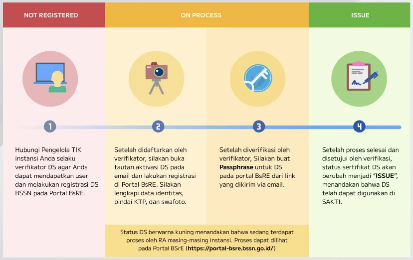

import { Steps, Aside } from '@astrojs/starlight/components';
import MenuSakti from '~/components/MenuSakti.astro';
import SumberAsli from '~/components/SumberAsli.astro';

SAKTI menggunakan Digital Signature (DS) dengan sertifikat yang
diterbitkan oleh BSrE BSSN. DS dipakai sebagai bentuk tanda tangan
elektronik pada dokumen SAKTI oleh pejabat, misalnya SPP dan SPM. Saat
ini DS diwajibkan bagi KPA, PPK, PPSPM, dan Bendahara Pengeluaran sebagai
pejabat yang melakukan transaksi keuangan di SAKTI. Fitur monitoring DS
mempermudah pejabat melihat status DS-nya: apakah dapat langsung
digunakan atau perlu didaftarkan terlebih dahulu.

<MenuSakti />

## Siapa yang dapat memantau status DS

Status DS dapat dilihat oleh:

- User masing-masing pejabat — melalui **dashboard** setelah login dan
  menu **Digital Signature**.
- Admin Satker — melalui menu pengelolaan pengguna.
- Admin Kementerian, KPPN, dan Kanwil DJPb — melalui MonSAKTI **Admin →
  Monitoring Sertifikat Digital Signature BSSN**.

Status DS di dashboard hanya muncul untuk user KPA, PPK, PPSPM, dan
Bendahara; selain itu tidak muncul dan tidak diwajibkan terdaftar DS.

## Menu Digital Signature

Menu **Digital Signature** menampilkan status sertifikat DS dan
menyediakan fitur reset Passphrase DS BSSN. Setelah tombol **Reset
Passphrase DS BSSN** diklik, BSrE mengirimkan link reset ke email yang
terdaftar di BSSN. Email terdaftar di BSSN bisa sama atau berbeda dengan
email SAKTI, tergantung pada saat pendaftaran oleh verifikator masing-
masing K/L.

## Pengecekan oleh Admin Satker

Admin Satker dapat melihat status DS BSSN masing-masing user di
satkernya: masuk ke menu pengelolaan pengguna, klik user yang ingin
dicek, lalu klik tombol **"check"** pada kolom status DS BSSN.

## Jenis status DS berdasarkan warna

| Status DS | Penjelasan | Tindak lanjut |
|---|---|---|
| ISSUE | Status berwarna hijau menandakan bahwa sertifikat DS sudah terbit dan DS dapat digunakan | User sudah dapat menggunakan DS |
| NOT REGISTERED / EXPIRED | Status berwarna merah menandakan user belum mendaftarkan DS ke BSSN | Silakan user mengajukan permohonan pendaftaran sertifikat DS ke BSSN via masing-masing K/L |
| NEW / RENEW / REVOKE / UPDATE / NO CERTIFICATE | Status berwarna oranye menandakan terdapat proses yang sedang berjalan di Portal BSrE (AMS), atau kedaluwarsa (expired) | Silakan buka portal BSrE untuk melihat detail status yang sedang berjalan. Menunggu tindak lanjut dari user/verifikator K/L |

## Alur pendaftaran sertifikat DS BSSN

<Steps>

1. (NOT REGISTERED) Hubungi Pengelola TIK instansi Anda selaku
   verifikator DS agar Anda dapat mendapatkan user dan melakukan
   registrasi DS BSSN pada Portal BSrE.
2. (ON PROCESS) Setelah didaftarkan oleh verifikator, silakan buka
   tautan aktivasi DS pada email dan lakukan registrasi di Portal BSrE.
   Silakan lengkapi data identitas, pindai KTP, dan swafoto.
3. (ON PROCESS) Setelah diverifikasi oleh verifikator, silakan buat
   Passphrase untuk DS pada Portal BSrE dari link yang dikirim via email.
4. (ISSUE) Setelah proses selesai dan disetujui oleh verifikator, status
   sertifikat DS akan berubah menjadi "ISSUE", menandakan bahwa DS telah
   dapat digunakan di SAKTI.

</Steps>

Status DS berwarna kuning menandakan sedang terdapat proses oleh RA
masing-masing instansi; proses dapat dilihat pada [Portal
BSrE](https://portal-bsre.bssn.go.id/).

Verifikator instansi adalah Unit Pengelola TIK pada masing-masing K/L
(PUSDATIN) atau Pemda (DISKOMINFO) yang telah melakukan PKS dengan BSSN.
Pada saat pengguna mengisi identitas data diri, NIP dan NIK akan
dicocokkan dengan database di Dukcapil dan juga BKN; apabila tidak sama,
akan diminta perbaikan.

## Ketentuan

- Untuk penerbitan, perubahan data/pembaruan sertifikat, dan pencabutan,
  silakan kunjungi [Portal BSrE](https://portal-bsre.bssn.go.id/) (AMS).
- Password pada Portal BSrE dan Passphrase adalah dua hal yang berbeda;
  pastikan tidak tertukar agar tidak terjadi kesalahan TTE.
- Sertifikat DS BSSN dapat diperbarui sebelum tanggal kedaluwarsa dengan
  mengajukan pembaruan pada Portal BSrE.
- Reset passphrase tidak akan memperpanjang tanggal kedaluwarsa sertifikat
  DS.
- Untuk pertanyaan lanjutan, hubungi Pengelola TIK instansi Anda selaku
  Registration Authority. Untuk ketidaksesuaian data pada saat
  pendaftaran, hubungi [Helpdesk BSrE](https://bsre.bssn.go.id/kontak)
  dan/atau [BKN](https://support-siasn.bkn.go.id/).

## Perpanjangan sertifikat elektronik

**Apabila belum expired:**

<Steps>

1. Login ke [Portal BSrE](https://portal-bsre.bssn.go.id/).
2. Klik menu **Sertifikat Saya > Daftar Sertifikat Elektronik > Aksi >
   Permohonan Pembaruan > Submit**.
3. Cek email; akan ada email Link Set passphrase. Klik link set
   passphrase dan lakukan set passphrase sesuai ketentuan BSSN.
4. Anda akan mendapatkan email bahwa sertifikat DS BSSN telah aktif.

</Steps>

**Apabila sudah expired:**

<Steps>

1. Login ke [Portal BSrE](https://portal-bsre.bssn.go.id/).
2. Klik menu **Sertifikat Saya > Permohonan Baru > eSign > Submit**.
3. Cek email; akan ada email Link Set passphrase. Klik link set
   passphrase dan lakukan set passphrase sesuai ketentuan BSSN.
4. Anda akan mendapatkan email bahwa sertifikat DS BSSN telah aktif.

</Steps>

## Akses monitoring bagi Pengelola TIK K/L

Pengelola TIK / Pusdatin / Pusintek K/L dapat mendaftarkan user SAKTI
untuk mendapatkan akses monitoring Digital Signature melalui MonSAKTI.
Pendaftaran dilakukan sebagai peran `KEMENTERIAN_ADMIN` dan dikirimkan ke
HAI Kemenkeu — lihat
[pendaftaran pengguna](/mulai/pendaftaran-user/).

## Masalah umum

Status DS Expired

Lakukan penerbitan sertifikat ulang pada Portal BSrE.

Status DS Double Certificate

Revoke/cabut salah satu sertifikat dengan masa aktif yang paling pendek.

DS sudah terdaftar namun statusnya no_certificate

Kemungkinan certificate corrupt. Silakan mengajukan permohonan
certificate baru melalui Portal BSrE.

DS sudah terdaftar dan memiliki sertifikat dengan status REVOKE

Pengguna memiliki sertifikat namun telah dicabut; silakan melakukan
penerbitan ulang dari Portal BSrE.

Perbedaan status antara Portal BSrE dengan SAKTI

Terdapat delay; lakukan "Refresh Status Digital Signature" pada SAKTI
(sinkronisasi BSSN–SAKTI diperbarui tiap 4 jam). Kemungkinan lain adalah
NIP/NIK berbeda antara data di BSSN dan SAKTI; apabila kesalahan terdapat
di BSrE, lakukan perbaikan mandiri di MySAPK atau usulkan perubahan
melalui [support SIASN BKN](https://support-siasn.bkn.go.id/).

Salah passphrase padahal sudah yakin passphrase benar

Kemungkinan sertifikatnya rusak. Lakukan revoke/pencabutan melalui tombol
aksi di menu Sertifikat Saya terlebih dahulu, lalu ajukan permohonan
baru.

<Aside type="caution" title="Perlu verifikasi">
Juknis 2024 menulis **Administrasi > Penandatanganan > Digital
Signature**, sedangkan juknis 2023 menulis **Administrasi > Umum >
Jabatan > Digital Signature**. Pada menu aplikasi saat ini form ini
berada di **Administrasi > Penandatangan > Digital Signature**.
</Aside>

## Terkait

- [Mengelola Referensi Penandatangan](/admin/penandatangan/penandatangan/)
- [Melengkapi Data Pejabat Perbendaharaan](/admin/pengguna/pejabat-perbendaharaan/)
- [PKIPA](/admin/pkipa/)

## Sumber

<SumberAsli />
