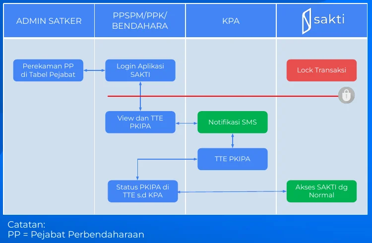

import { CardGrid, LinkCard, Aside } from '@astrojs/starlight/components';
import MenuSakti from '~/components/MenuSakti.astro';
import SumberAsli from '~/components/SumberAsli.astro';

Pernyataan Komitmen Integritas Pelaksanaan Anggaran (PKIPA) diterapkan
SAKTI untuk akuntabilitas penyelenggaraan kewenangan pengguna operasional
modul, sebagaimana disebutkan pada Pasal 10A PMK Nomor 158 Tahun 2023
tentang Perubahan atas PMK Nomor 171/MK.05/2021 tentang Pelaksanaan
Sistem SAKTI.

<MenuSakti />

PKIPA terdiri dari empat jenis:

- **PKIPA Awal**
- **PKIPA Periodik**
- **PKIPA Perubahan**
- **PKIPA Transaksi** (sudah berjalan)

PKIPA Awal, Periodik, dan Perubahan berupa dokumen yang ditandatangani
masing-masing pejabat perbendaharaan dan diketahui oleh KPA.

PKIPA Transaksi merupakan pernyataan integritas yang diterapkan pada
aplikasi SAKTI dengan cara disematkan menu checklist sebelum melakukan
validasi dokumen yang menjadi kewenangan masing-masing pejabat
perbendaharaan.

## Dasar hukum

- Peraturan Menteri Keuangan Nomor 158 Tahun 2023 tentang Perubahan atas
  Peraturan Menteri Keuangan Nomor 171/MK.05/2021 tentang Pelaksanaan
  Sistem SAKTI.
- Piloting PKIPA Tahap I: Nota Dinas Sekretaris Ditjen Perbendaharaan
  Nomor ND-540/PB.1/2024 hal Implementasi Pernyataan Komitmen Integritas
  Pelaksanaan Anggaran (PKIPA) pada Aplikasi SAKTI tanggal 06 Februari
  2024.
- Piloting PKIPA Tahap II: Nota Dinas Direktur Sistem Perbendaharaan
  Nomor ND-335/PB.7/2025 hal Pemberitahuan Implementasi Pernyataan
  Komitmen Integritas Pelaksanaan Anggaran (PKIPA) pada Aplikasi SAKTI
  Tahap II tanggal 21 Maret 2025.
- Piloting PKIPA Tahap III: Nota Dinas Direktur Sistem Informasi dan
  Teknologi Perbendaharaan Nomor ND-222/PB.8/2025 hal Penyampaian Usulan
  Tanggal Implementasi Tanda Tangan Elektronik Tersertifikasi pada Sistem
  SAKTI untuk Dokumen Pernyataan Komitmen Integritas Pelaksanaan Anggaran
  tanggal 24 Februari 2025.

## Alur proses

PP = Pejabat Perbendaharaan. Admin Satker merekam pejabat perbendaharaan
di Tabel Pejabat; pejabat login ke aplikasi SAKTI, melihat dan
menandatangani (TTE) PKIPA; KPA menerima notifikasi SMS dan
menandatangani hingga status PKIPA ter-TTE sampai KPA, sehingga pejabat
dapat mengakses SAKTI dengan normal. Sebelum PKIPA selesai, berlaku lock
transaksi.

## Ketentuan PKIPA di aplikasi SAKTI

1. PKIPA merupakan dokumen yang wajib ditandatangani seluruh Pejabat
   Perbendaharaan aktif di tingkat Satuan Kerja secara periodik
   (semesteran).
2. Masing-masing pejabat perbendaharaan yang belum menandatangani PKIPA
   sampai KPA tidak dapat melakukan/melanjutkan transaksi di aplikasi
   SAKTI (lock transaksi).
3. Lock transaksi dilakukan pada menu di aplikasi SAKTI sesuai kewenangan
   masing-masing pejabat.
4. PKIPA ditandatangani terlebih dahulu oleh pejabat perbendaharaan,
   kemudian dilanjutkan ditandatangani KPA.
5. Penambahan dan perubahan daftar nama Pejabat Perbendaharaan di menu
   PKIPA dilakukan oleh Admin Satker di menu Pejabat Perbendaharaan.

## Peran user SAKTI yang terlibat

| Peran | Peran dalam proses PKIPA |
|---|---|
| Admin Satker | Melakukan perekaman, perubahan, dan penghapusan ketidaksesuaian daftar nama pejabat PKIPA |
| PPSPM, PPK, Bendahara | Melakukan penandatanganan PKIPA pejabat perbendaharaan |
| KPA | Melakukan penandatanganan PKIPA yang telah ditandatangani pejabat perbendaharaan, serta penandatanganan PKIPA KPA |
| Admin KPPN | Monitoring PKIPA satker lingkup kerjanya |

## Panduan

<CardGrid>
	<LinkCard
		title="Mengelola Referensi Pejabat PKIPA"
		description="Penambahan, perubahan, dan penghapusan pejabat pada menu PKIPA."
		href="/admin/pkipa/referensi-pejabat-pkipa/"
	/>
	<LinkCard
		title="Menandatangani PKIPA secara Elektronik"
		description="TTE PKIPA oleh pejabat perbendaharaan dan KPA, serta monitoring oleh Admin KPPN."
		href="/admin/pkipa/tte-pkipa/"
	/>
</CardGrid>

## Pertanyaan yang sering diajukan

Mengapa KPA tidak dapat melakukan penandatanganan PKIPA?

Mohon KPA menandatangani dokumen PKIPA atas dirinya sendiri hingga status
pada kolom TTE KPA berubah menjadi "Sudah TTE". Selanjutnya, silakan
memanfaatkan fitur TTE Sekaligus untuk menandatangani PKIPA Pejabat
Perbendaharaan lainnya.

Apa yang harus dilakukan jika muncul PKIPA pada periode 20241 padahal baru implementasi di Semester I Tahun 2025?

Silakan Admin Satker dapat menghapus dokumen PKIPA atas periode Semester
I Tahun 2024.

Jika data seperti alamat, dll yang tertera pada kop dokumen PKIPA salah, bagaimana cara menggantinya?

Silakan Admin Satker dapat menyesuaikan data tersebut pada menu
**Referensi > Umum > COA > Satker**.

Mengapa PPSPM tidak dapat menandatangani PKIPA dengan notifikasi "Gagal Menandatangani Statement of Responsibility"?

Yang bersangkutan teridentifikasi masih memiliki kewenangan sebagai KPA
pada usernya, padahal sudah tidak menjabat sebagai KPA. Seharusnya,
Satker mengajukan perubahan user ke KPPN.

Mengapa tidak ada tombol aksi pada user pejabat perbendaharaan?

Silakan bandingkan NIK antara yang tercantum pada user dengan NIK yang
terekam pada menu pejabat perbendaharaan, karena pasti berbeda. Mohon
admin satker menghapus data pejabat tersebut, lalu rekam dan aktivasi
OTP kembali.

Seluruh Pejabat Perbendaharaan telah menandatangani PKIPA hingga status TTE KPA menjadi "Sudah TTE", namun mengapa masih tidak dapat mengakses menu terkait? (lock transaksi)

Silakan coba logout lalu login kembali.

Apabila terdapat pergantian Pejabat Perbendaharaan, mengapa pejabat yang baru tidak muncul pada menu PKIPA?

Silakan generate ulang dengan klik tombol refresh pada bagian kanan menu
PKIPA. Jika masih belum muncul, silakan keluar dari menu PKIPA, lalu coba
akses menu PKIPA kembali.

Jika KPA berganti, apakah PPK, PPSPM, dan Bendahara menandatangani dokumen PKIPA kembali?

Tidak perlu. Jika terdapat pergantian pejabat perbendaharaan, maka hanya
pejabat baru tersebut yang menandatangani dokumen PKIPA.

Jika pejabat perbendaharaan ingin membatalkan PKIPA yang telah ditandatangani, bagaimana caranya?

Apabila dokumen PKIPA baru ditandatangani oleh pejabat perbendaharaan
terkait, Admin Satker dapat menghapus dokumen tersebut. Namun, apabila
status pada kolom TTE KPA telah menjadi "Sudah TTE", dokumen PKIPA tidak
dapat dihapus.

Sertifikat elektronik BSSN telah expired

Silakan login ke [Portal BSrE](https://portal-bsre.bssn.go.id/) untuk
proses pembuatan sertifikat elektronik baru. Dapat juga menghubungi
Kontak BSrE Digital Signature.

<Aside type="caution" title="Perlu verifikasi">
Juknis menulis menu **Administrasi > Admin > Pernyataan Komitmen
Integritas**; di menu aplikasi form ini berada langsung di bawah
**Administrasi** sebagai **Administrasi > Pernyataan Komitmen
Integritas**.
</Aside>

## Sumber

<SumberAsli />
