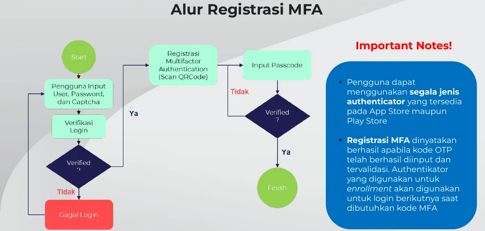

import { Steps } from '@astrojs/starlight/components';
import SumberAsli from '~/components/SumberAsli.astro';

**Multi-Factor Authentication (MFA)** adalah metode autentikasi yang
mengharuskan pengguna memberikan dua atau lebih faktor verifikasi untuk
memperoleh akses aplikasi. Tujuannya meningkatkan keamanan informasi dengan
mengharuskan pengguna mengidentifikasi diri lebih dari sekadar nama pengguna
dan kata sandi.

## Prasyarat

- **Smartphone** — digunakan untuk mengunduh aplikasi authenticator sebagai
  tanda bahwa pengguna adalah pemilik akun yang sah.
- **Authenticator** — menghasilkan kode satu kali pakai (OTP) yang berubah
  setiap beberapa detik untuk memverifikasi identitas pengguna. Pengguna
  dapat memakai segala jenis authenticator yang tersedia di App Store maupun
  Play Store.
- **Pengaturan waktu** — perangkat yang digunakan sebagai authenticator
  wajib memakai pengaturan waktu secara otomatis.

## Langkah

### Alur pendaftaran awal MFA

<Steps>

1. Siapkan ponsel Android/iOS, buka Play Store/App Store, cari dengan kata
   kunci **"authenticator"**, lalu unduh salah satu aplikasi authenticator
   (disarankan Google Authenticator atau Microsoft Authenticator, gratis).

2. Masukkan username, password, dan captcha aplikasi SAKTI; akan muncul
   *popup* Pendaftaran MFA.

3. Buka aplikasi authenticator yang telah diunduh, klik tambah **(+)**, lalu
   pilih **scan a QR Code**.

4. Scan barcode yang muncul pada halaman popup Pendaftaran MFA hingga muncul
   "SAKTI-APP: USERNAME" pada aplikasi authenticator.

5. Masukkan **6 digit kode** ke halaman SAKTI, lalu klik tombol
   **Autentikasi Multifaktor**.

</Steps>

Registrasi MFA dinyatakan berhasil apabila kode OTP telah berhasil diinput
dan tervalidasi. Authenticator yang digunakan untuk enrollment akan
digunakan untuk login berikutnya saat dibutuhkan kode MFA.

## Login setelah MFA terdaftar

- Scan barcode hanya dilakukan **1 kali**. Apabila saat login tidak muncul
  barcode, berarti user telah terdaftar; masukkan kode pada authenticator
  yang didaftarkan.
- Masa berlaku passcode adalah **30 detik**.
- Kode Time-based one-time password (TOTP) otomatis *expired* setiap
  **90 hari**.
- Kode TOTP disimpan selama pengguna mengakses pada perangkat yang sama.

## Reset MFA

- Menghapus MFA di ponsel **tidak** menghapus data MFA yang terdaftar di
  SAKTI.
- Reset MFA user Satker dilakukan dengan mengajukan permohonan ke **KPPN**.
- User Non-Satker mengajukan permohonan reset MFA ke **Admin Pusat** melalui
  HAI DJPb (informasikan Nama, NIK, No HP, Kode Satker) menggunakan email
  kedinasan.
- Fitur Reset MFA tersedia pada menu **Administrasi > Pengguna > Reset Kata
  Sandi** (user KPPN) — admin KPPN mengakses menu tersebut lalu klik
  **Reset MFA**.

## Terkait

- [Masuk (Login) ke Aplikasi SAKTI](/mulai/akses-aplikasi/login-sakti/)
- [Mengubah dan Mereset Kata Sandi](/mulai/akses-aplikasi/ubah-kata-sandi/)
- [Mengaktifkan OTP Pejabat Perbendaharaan](/mulai/pendaftaran-user/aktivasi-otp/)

## Sumber

<SumberAsli />
