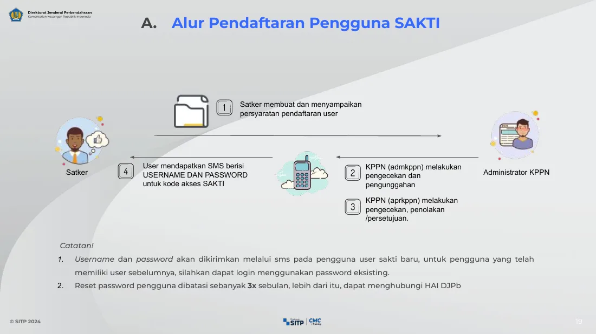

import { Steps } from '@astrojs/starlight/components';
import SumberAsli from '~/components/SumberAsli.astro';

Sebelum mendaftarkan pengguna baru, pahami dokumen persyaratan dan jalur
pendaftaran yang berlaku untuk tipe kantor Anda. Seluruh aktivitas pendaftaran,
perubahan, dan penghapusan user tercatat di database meskipun user telah
dihapus dari SAKTI.

## Prasyarat

Dokumen yang diperlukan untuk pendaftaran pengguna SAKTI:

1. **SK Penetapan Pengguna SAKTI** (PDF bertanda tangan).
2. **Form Pendaftaran Pengguna SAKTI** (PDF bertanda tangan dan Excel).

Hal yang perlu diperhatikan saat mengisi formulir:

- Jangan mengubah format formulir yang sudah ditetapkan; pastikan semua kolom
  berformat *text*.
- Isian user dimulai dari **baris 8**.
- Penulisan peran disesuaikan dengan petunjuk pada `bit.ly/rolesakti`.
- Tidak boleh ada rangkap jabatan antara pengguna operasional dalam satu modul.
- Isian NIP dapat diisi NIP/NRP atau NIK apabila yang didaftarkan bukan
  pegawai.
- Gunakan email kedinasan (`@sakti.mail.go.id` / `@kemenkeu.go.id`). Apabila
  belum memiliki email SAKTI, usulkan pendaftaran SAKTI Mail ke KPPN mitra
  kerja.
- Format tanggal SK adalah `dd-mm-yyyy`.

## Alur proses

### Alur pendaftaran tipe Satker

<Steps>

1. Pemohon membuat dan menyampaikan persyaratan pendaftaran user ke KPPN,
   dapat melalui HAI-CSO (OMSPAN).

2. KPPN (admuser) melakukan pengecekan dan pengunggahan.

3. KPPN (apruser) melakukan pengecekan, penolakan, atau persetujuan.

4. User mendapat SMS berisi kode akses SAKTI.

5. User login menggunakan ID yang dikirim, mengubah kata sandi, dan segera
   melakukan [konfirmasi data nama dan NIK](/mulai/akses-aplikasi/konfirmasi-nama-nik/).

</Steps>

### Alur pendaftaran tipe selain Satker

Untuk tipe Kanwil K/L, Unit, Kementerian, APIP, KPPN, Kanwil, dan lainnya:

<Steps>

1. Pemohon membuat dan menyampaikan persyaratan pendaftaran ke Admin Pusat
   melalui **Tiket HAI DJPb** (hai.kemenkeu.go.id) menggunakan email kedinasan.

2. Admin Pusat melakukan pengecekan dan pengunggahan.

3. Admin Pusat memverifikasi pendaftaran user dan membalas tiket user.

4. User mendapat SMS berisi kode akses SAKTI.

5. User login menggunakan ID yang dikirim, mengubah kata sandi, dan segera
   melakukan konfirmasi data nama dan NIK.

</Steps>

## Kewenangan pendaftaran

| Tipe pengguna | Pendaftaran dilakukan oleh |
|---|---|
| Satker (level UAKPA) | KPPN |
| Satker level Wilayah, Unit Eselon I, dan K/L | HAI DJPb |
| APIP (Auditor Kementerian) | HAI DJPb |
| BUN (KPPN dan Kanwil DJPb) | HAI DJPb |
| DJPb (Sekretariat dan Direktorat) | HAI DJPb |
| DJKN (Pembina) | HAI DJPb |
| DJA (Penelaah) | HAI DJPb |
| Bappenas | HAI DJPb |
| BPK (Auditor) | HAI DJPb |
| Widyaiswara | HAI DJPb |

## Terkait

- [Mendaftarkan Pengguna Tipe Satker K/L](/mulai/pendaftaran-user/satker-kl/)
- [Mengajukan Perubahan Pengguna](/mulai/pendaftaran-user/perubahan-pengguna/)
- [Mengaktifkan OTP Pejabat Perbendaharaan](/mulai/pendaftaran-user/aktivasi-otp/)

## Sumber

<SumberAsli />
