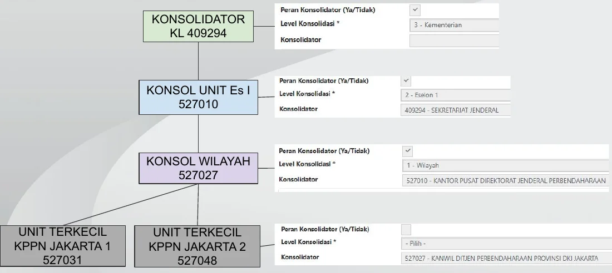

import { Steps, Aside } from '@astrojs/starlight/components';
import MenuSakti from '~/components/MenuSakti.astro';
import SumberAsli from '~/components/SumberAsli.astro';

Perubahan konsolidator — meliputi peran konsolidator, konsolidator, dan
level konsolidasi kode satker — dilakukan oleh Operator Pelaporan melalui
menu Konfigurasi Sistem.

<MenuSakti />

## Siapa yang dapat mengubah

| Tingkat | Tipe login & kewenangan | Yang dapat dilakukan |
|---|---|---|
| Kementerian | Tipe login Kementerian, kewenangan Operator Pelaporan Kementerian | Monitoring dan perubahan konfigurasi seluruh kode satker di bawahnya; perubahan dapat didelegasikan ke Operator Pelaporan tingkat Unit di bawahnya |
| Unit (Eselon I) | Tipe login Unit, kewenangan Operator Pelaporan Unit | Monitoring dan perubahan konfigurasi seluruh kode satker di bawah unitnya; perubahan tidak dapat didelegasikan ke Operator Pelaporan tingkat Wilayah di bawahnya |
| Satker | Tipe login Satker, kewenangan Operator Pelaporan | Monitoring dan perubahan konfigurasi satkernya sendiri |
| Wilayah | — | Tidak dapat mengubah konsolidator secara mandiri; tetap dapat monitoring daftar satker konsolidasi di bawahnya. Bila menemukan satker yang bukan satker yang dikonsolidasi, penyesuaian dilakukan Operator Pelaporan tingkat Satker/Unit/Kementeriannya |

Kewenangan user dapat dilihat pada menu pengelolaan pengguna
(**Administrasi > Pengelolaan Pengguna dan Kontrol Akses > Pengelolaan
Pengguna** — jalur menurut juknis).

## Langkah

<Steps>

1. Login dengan user Operator Pelaporan sesuai tingkatnya.
2. Buka menu **Referensi > Umum > Konfigurasi Sistem (ALL)**.
3. Pilih kode satker, lalu klik **Ubah**.
4. Sesuaikan isian berikut:

   | Isian | Keterangan |
   |---|---|
   | **Peran Konsolidator (Ya/Tidak)** | Ya: Kementerian, Eselon 1, dan Wilayah yang ditunjuk sebagai konsolidator satker di bawahnya; Tidak: tidak ditunjuk sebagai konsolidator |
   | **Konsolidator** | Diisi kode satker yang menjadi konsolidator setingkat di atasnya |
   | **Level Konsolidasi** | Wilayah (UAPPA/BW): konsolidator tingkat wilayah; Eselon 1 (UAPPA/B-E1): konsolidator tingkat unit; Kementerian (UAPA/B): konsolidator tingkat kementerian |

</Steps>

## Daftar Satker Konsolidator

Daftar Satker Konsolidator adalah daftar satuan kerja yang akan
dikonsolidasikan (berada satu tingkat di bawahnya) oleh satuan kerja yang
sedang dipilih. Contoh isi per tingkat:

- Tingkat Kementerian: satker-satker level Unit Eselon I
- Tingkat Eselon I: satker-satker level wilayah
- Tingkat Wilayah: satker-satker level vertikal terkecil

Apabila ditemukan ketidaksesuaian pada daftar satker konsolidator,
Operator Pelaporan tingkat Kementerian (atau tingkat Unit untuk lingkup
unitnya) dapat melakukan perubahan.

## Contoh kasus

Contoh susunan konsolidator berjenjang dari kementerian hingga unit terkecil:

| Satker | Peran Konsolidator | Level Konsolidasi | Konsolidator |
|---|---|---|---|
| Konsolidator K/L | dicentang | Kementerian | (kosong) |
| Konsolidator Unit Eselon I | dicentang | Eselon 1 | kode satker konsolidator K/L |
| Konsolidator Wilayah | dicentang | Wilayah | kode satker konsolidator Unit Eselon I |
| Unit terkecil | tidak dicentang | (tidak dipilih) | kode satker konsolidator Wilayah |

## Ketentuan

- Referensi standar SAKTI hanya mengenal tipe referensi Satker, Unit, dan
  Kementerian.
- Referensi konsolidator Wilayah / Kanwil adalah referensi bentukan
  transaksi yang dapat berubah secara dinamis; jika terdapat kode kanwil,
  maka satker tidak akan berada dalam kewenangan wilayahnya lagi.
- Level Konsolidasi pada satuan kerja dipilih yang paling tinggi. Contoh:
  pada satuan kerja Sekretariat Jenderal pada umumnya harus melakukan
  konsolidasi level Kementerian, Eselon 1, serta level satker, sehingga
  level konsolidasi yang dipilih pada saat konfigurasi adalah level
  Kementerian.

## Masalah umum

Error "Level satker user login tidak dibolehkan lebih besar dari pada level satker konfigurasi" saat cetak laporan tingkat Wilayah/Unit/Kementerian

Cek kembali level konsolidasi satkernya; level konsolidasi disesuaikan
dengan kewenangan satker yang seharusnya.

Untuk pendaftaran user tipe Wilayah/Unit Eselon I/Kementerian khusus
konsolidator aset dan pelaporan, lihat [Mendaftarkan Pengguna Tipe Kanwil
K/L, Unit Eselon I, dan
Kementerian](/mulai/pendaftaran-user/kanwil-unit-kementerian/).

<Aside type="caution" title="Perlu verifikasi">
- Juknis 2022 menulis menu **Administrasi > Umum > Konfigurasi Sistem
  (All)**; di menu aplikasi saat ini form berada di **Referensi > Umum**
  dan terdapat dua form, **Konfigurasi Sistem** dan **Konfigurasi Sistem
  (ALL)** — padanan form perlu dipastikan.
- Juknis menyebut pola User ID `oprba_kodesatker_NIP` (Kementerian),
  `opru_kodesatker_NIP` (Unit), dan `opr_kodesatker_NIP` (Satker),
  sedangkan juknis 2024 menyatakan login memakai username NIK.
- Slide untuk tingkat Unit menulis "User Operator Pelaporan tingkat
  Kementerian" pada kalimat kewenangan; artikel ini menafsirkannya
  sebagai tingkat Unit.
</Aside>

## Terkait

- [Memahami Peran dan Kewenangan Pengguna SAKTI](/admin/role/)
- [Mendaftarkan Pengguna Tipe Kanwil K/L, Unit Eselon I, dan Kementerian](/mulai/pendaftaran-user/kanwil-unit-kementerian/)

## Sumber

<SumberAsli />
